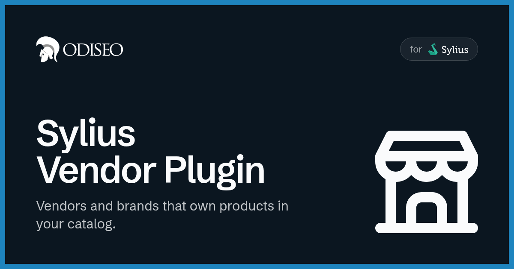
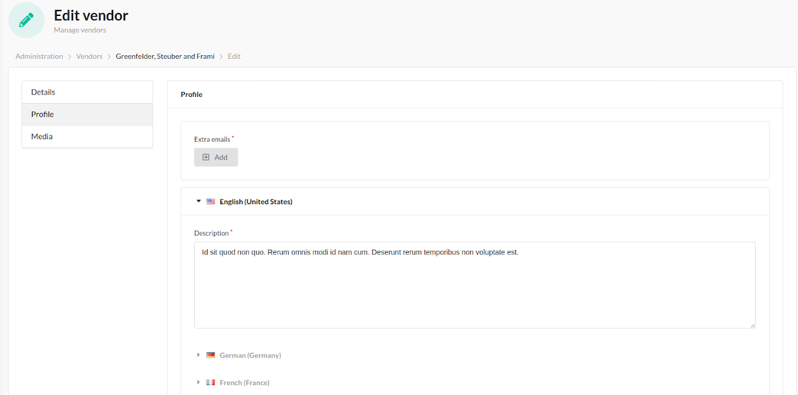
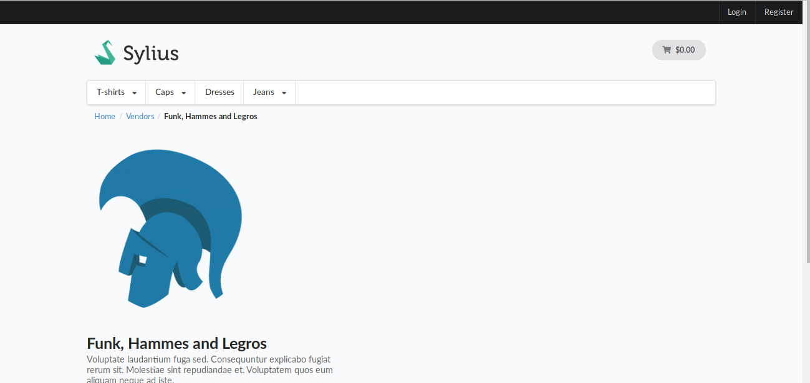
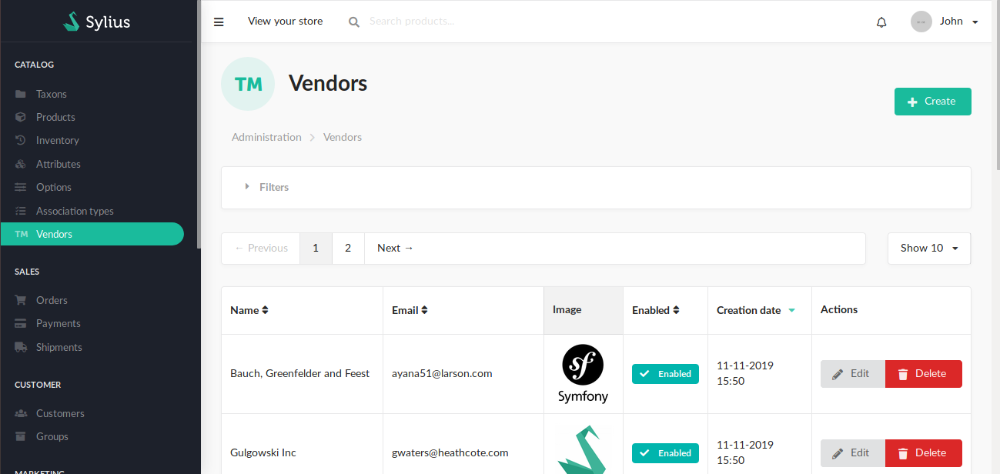
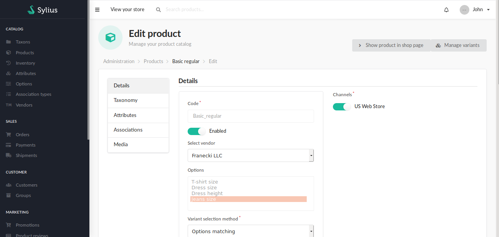

<p align="center">
    <a href="https://odiseo.io/en/products/sylius-plugins?utm_source=github&utm_medium=readme&utm_campaign=sylius-vendor-plugin" target="_blank">
        
    </a>
</p>
<p align="center">
    <a href="https://packagist.org/packages/odiseoteam/sylius-vendor-plugin"></a>
    <a href="https://packagist.org/packages/odiseoteam/sylius-vendor-plugin"></a>
    <a href="https://github.com/odiseoteam/SyliusVendorPlugin/actions/workflows/build.yaml"></a>
    
    
    <a href="LICENSE"></a>
</p>

## Introduction

This plugin adds vendors (brands) to your Sylius store. A vendor is an entity that owns products and is fully manageable from the admin panel.

### What makes this plugin different?

- ✅ **Vendors per channel** - Enable each vendor on the channels you want
- ✅ **Translatable content** - The vendor description is translatable per locale
- ✅ **Multiple emails** - Each vendor has a primary email plus an unlimited list of extra emails
- ✅ **Logo management** - Logos are stored through a Gaufrette filesystem and rendered with Liip Imagine
- ✅ **Full REST API** - Admin CRUD and shop read endpoints, plus a multipart logo upload endpoint, wired automatically
- ✅ **Optional sitemap integration** - Vendor URLs in your sitemap via `stefandoorn/sitemap-plugin`
- ✅ **13 languages** - The admin and shop UI ship translated out of the box
- ✅ **Easy to extend** - Follows Sylius best practices (resources, twig hooks, services), so every part can be overridden

<details open>
<summary>
 Screenshots
</summary> <br />

<table>
    <tr>
        <td width="50%" align="center">
            
            <br /><sub><b>Admin:</b> Vendors with their logo, email and position</sub>
        </td>
        <td width="50%" align="center">
            
            <br /><sub><b>Editing:</b> General data, profile and media, per channel</sub>
        </td>
    </tr>
    <tr>
        <td width="50%" align="center">
            
            <br /><sub><b>Shop:</b> A page listing every vendor</sub>
        </td>
        <td width="50%" align="center">
            
            <br /><sub><b>Vendor page:</b> The vendor and the products it owns</sub>
        </td>
    </tr>
</table>

</details>

## Getting Started

### Install it in 6 steps ⚡

1. ✅ Require the plugin
2. ✅ Enable the plugin
3. ✅ Import the plugin configuration
4. ✅ Import the routes
5. ✅ Make your `Product` vendor-aware
6. ✅ Update the database

**[👉 Follow the installation guide](doc/installation.md)**

### Quick Example

Require the plugin:

```bash
composer require odiseoteam/sylius-vendor-plugin
```

Once the remaining steps are done, the REST API is registered automatically and a **Vendors** entry is added to the admin menu.

### Try the demo

You can see this plugin in action in our Sylius demo application:

- **[Frontend](https://marketplace-demo.odiseo.io/)**
- **[Administration](https://marketplace-demo.odiseo.io/admin)** with `odiseo: odiseo` credentials

## Premium features

Do you want advanced features? Take a look at our [Multi Vendor Marketplace Plugin](https://odiseo.io/en/products/sylius-marketplace-plugin?utm_source=github&utm_medium=readme&utm_campaign=sylius-vendor-plugin), which turns your Sylius store into a marketplace like Amazon, Etsy or eBay.

## Documentation

- 📦 **[Installation](doc/installation.md)** - Six steps, from Composer to the database
- 📖 **[Usage](doc/usage.md)** - Administration, shop routes and fetching a vendor in Twig
- 🔗 **[API](doc/api.md)** - The shop and admin endpoints
- 🌱 **[Fixtures](doc/fixtures.md)** - The vendor fixture and its options
- 🗺️ **[Sitemap](doc/sitemap.md)** - Vendor URLs in your sitemap
- 🧩 **[Customization](doc/customization.md)** - Overriding models, resources and templates
- 🧪 **[Tests](doc/tests.md)** - Running the suites with Docker or directly
- ⬆️ **[Upgrading](UPGRADE.md)** - What changes between versions
- 📝 **[Changelog](CHANGELOG.md)** - The project history
- 🤝 **[Contributing](CONTRIBUTING.md)** - How to send a contribution

## Compatibility

| Package | Version         |
| ------- | --------------- |
| PHP     | ^8.2            |
| Sylius  | 2.0 · 2.1 · 2.2 |

## Professional Support

This plugin is maintained by [Odiseo](https://odiseo.io/en?utm_source=github&utm_medium=readme&utm_campaign=sylius-vendor-plugin). Need help with it, or with any Sylius project?

- 🛠️ **[Sylius development](https://odiseo.io/en/contact-us?utm_source=github&utm_medium=readme&utm_campaign=sylius-vendor-plugin)** - Help with this plugin or any Sylius project
- 🔌 **[More Sylius plugins](https://odiseo.io/en/products/sylius-plugins?utm_source=github&utm_medium=readme&utm_campaign=sylius-vendor-plugin)** - Browse all our Sylius plugins

## License

[MIT](LICENSE).
